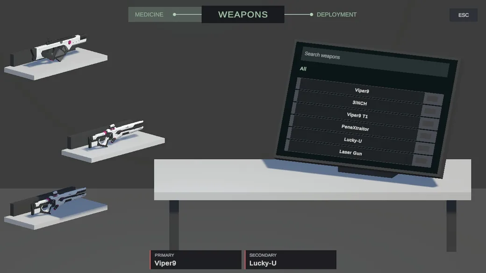

# Overdose · Estación de equipamiento

En esta estación 3D, el expositor gira con el ratón, el terminal abre el cajón elegido y la máquina actualiza la ranura cuando entrega el frasco.

[Descargar para Windows](https://github.com/shaw207/overdose-dynamic-ui/releases/tag/v1.0.0). Extrae el ZIP y abre `Overdose-DynamicUI.exe`.

## Probar la estación

- **WEAPONS** · Arrastra y suelta el expositor. Selecciona un arma y pulsa **Equip**.
- **MEDICINE** · Busca **Last Stand** y pulsa el resultado para abrir su cajón.
- **DEPLOYMENT** · Vuelve a **WEAPONS** y entra en **DEPLOYMENT**. Elige **Sub Zero Hold** y la ranura **N** para seguir la entrega. **DEPLOY** confirma la selección de esta sesión.

El botón **ESC** cierra la demo. Para abrirla en Unity **6000.5.10f1**, carga [EquipmentStation](Assets/Station/EquipmentStation.unity) y pulsa **Play**.

Interfaz de equipamiento de Chengxun Wu. Los modelos y recursos visuales se usan con permiso del equipo de *Overdose*. [Unity UI](licenses/Unity-UI.md) · [Liberation Sans](Assets/TextMesh%20Pro/Fonts/LiberationSans%20-%20OFL.txt)
